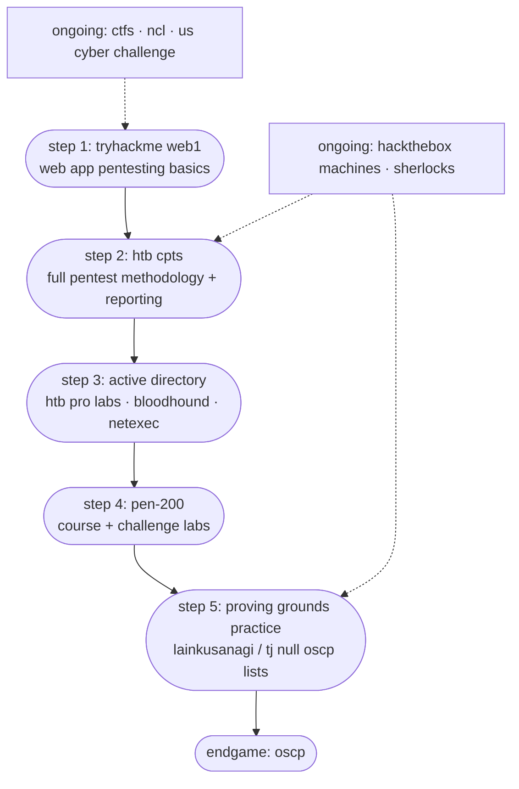

# luigi fernandez - cs @ gsu

## about me

i'm a cs student specializing in cybersecurity. incoming cyber intern @ capital one

i frequently compete in ctf competitions, and i most enjoy web app exploitation/pentesting.

learned a wide variety of network & security tools. my favorite tool is burp suite, with nmap at a close second.

i love monster hunter freedom unite, xenoblade, pokemon, persona.

## ctfs

- **us cyber challenge:** got into the eastern cyber camp through cyberquest, placed 2nd in the capstone ctf, and got invited to the us cyber bowl
- **uscc cyber bowl:** cont. of ^ , earned 1st place with my team at a national level, this ctf combined a vulnerability remediation presentation with a 12-hour ctf featuring network exploitation
    - conducted risk assessment and business impact analysis of CVE-2026-20127 in a large retailer’s SD-WAN scenario, evaluating the potential operational and business consequences of exploitation for the team’s vulnerability remediation presentation
- **ncl spring 2026:** top 10% individual (724/7,006), top 6% team (224/3,638)
- **ncl fall 2026:** need to pull the stats up again but we got top 75 for team game this time

## certs

comptia a+ · security+ · cysa+

planned: tryhackme web1 · hackthebox cpts  

## stuff i use

- **general security:** burp suite, nmap, wireshark, ghidra, bloodhound, netexec, cyberchef
- **soc side:** splunk, elastic, crowdstrike falcon, tenable, security onion
- **languages:** python, bash/zsh, powershell, c, java, sql

## roadmap

## find me

[linkedin](https://www.linkedin.com/in/YOUR-HANDLE)
