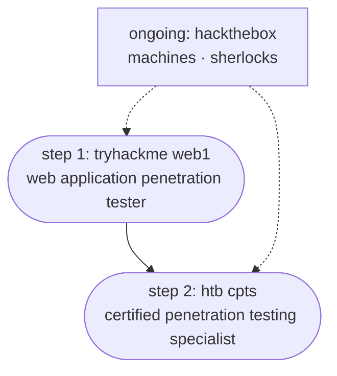

# luigi fernandez - cs @ gsu

## about me

i'm a cs student specializing in cybersecurity. incoming cyber intern @ capital one

i frequently compete in ctf competitions, and i most enjoy web app exploitation/pentesting.

learned a wide variety of network & security tools. my favorite tool is burp suite, with nmap at a close second.

i love monster hunter freedom unite, xenoblade, pokemon, persona.

## roadmap

